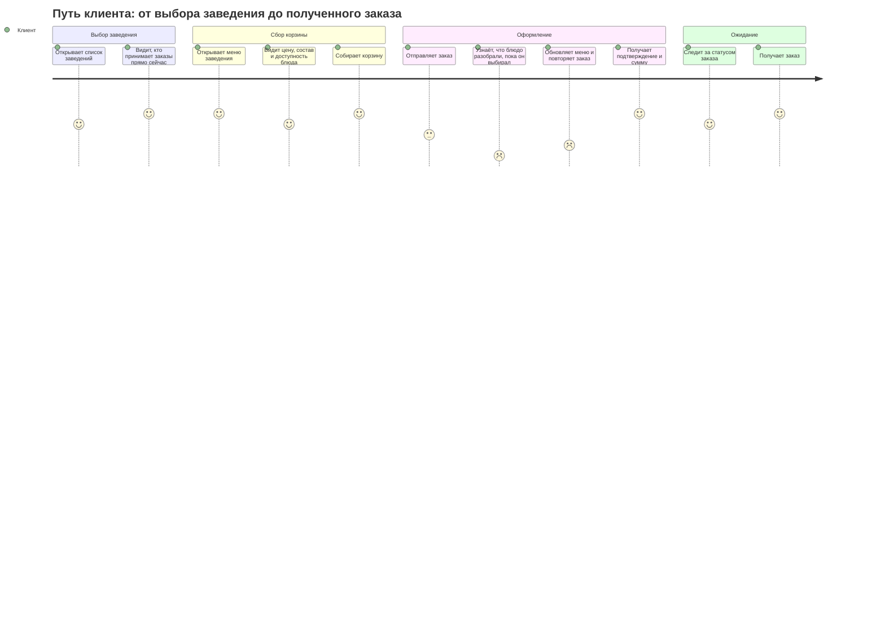
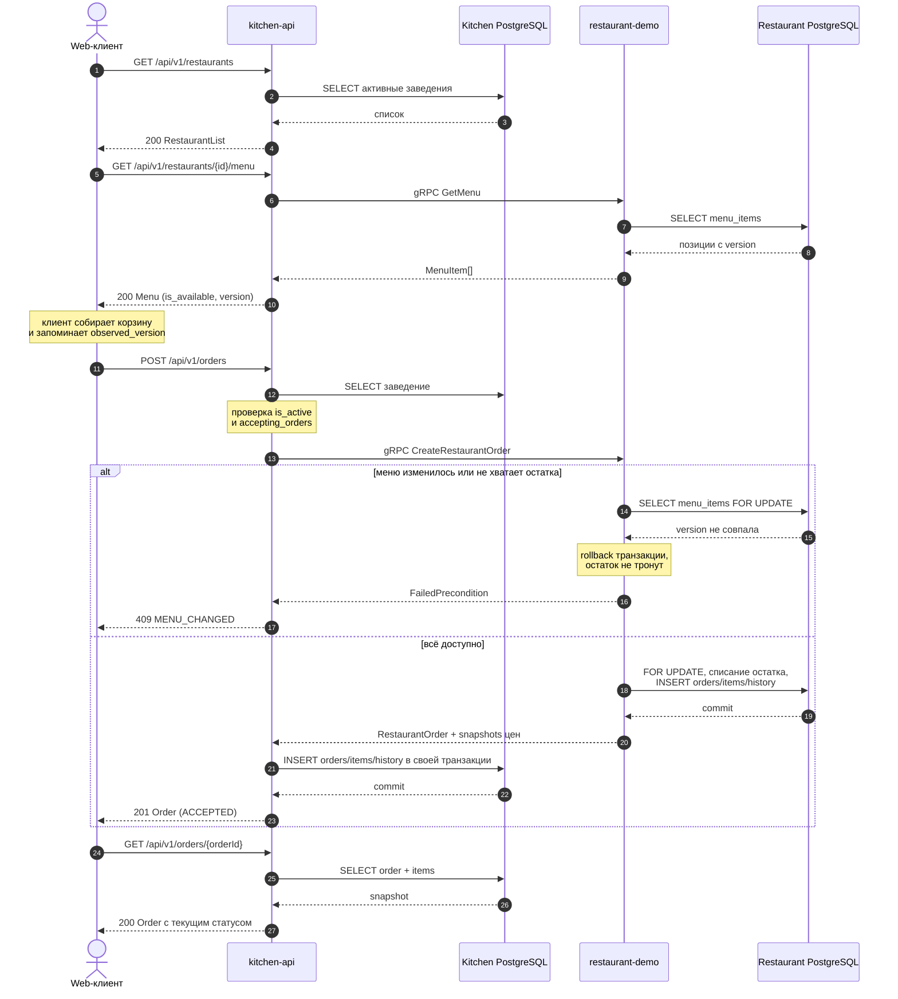
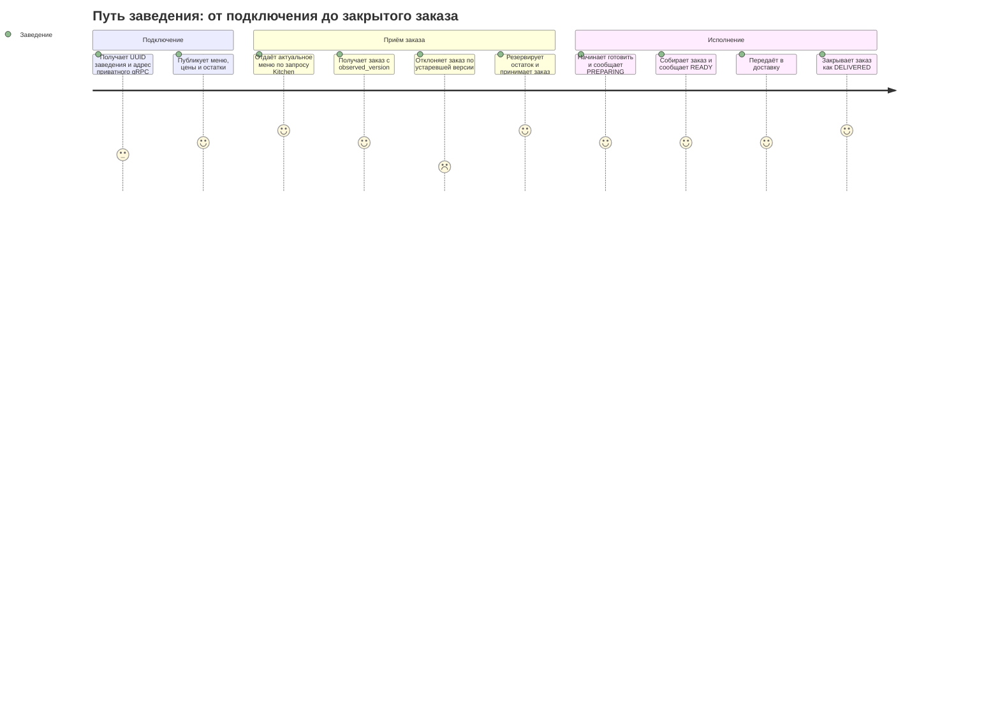
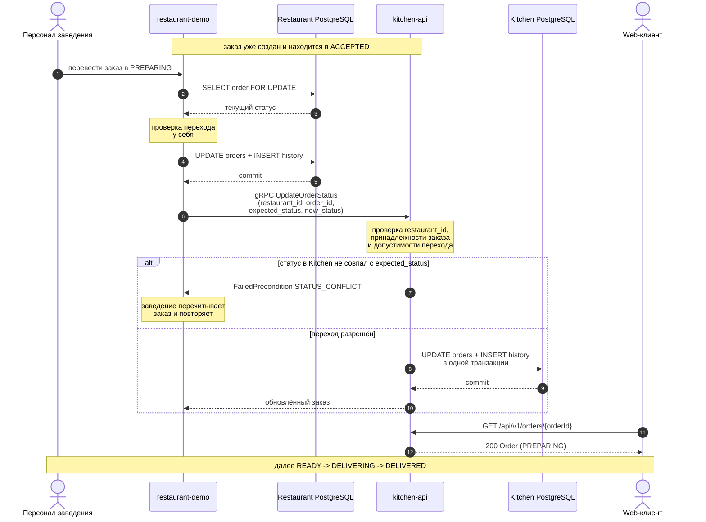
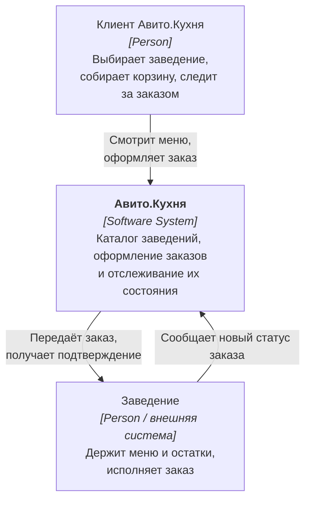
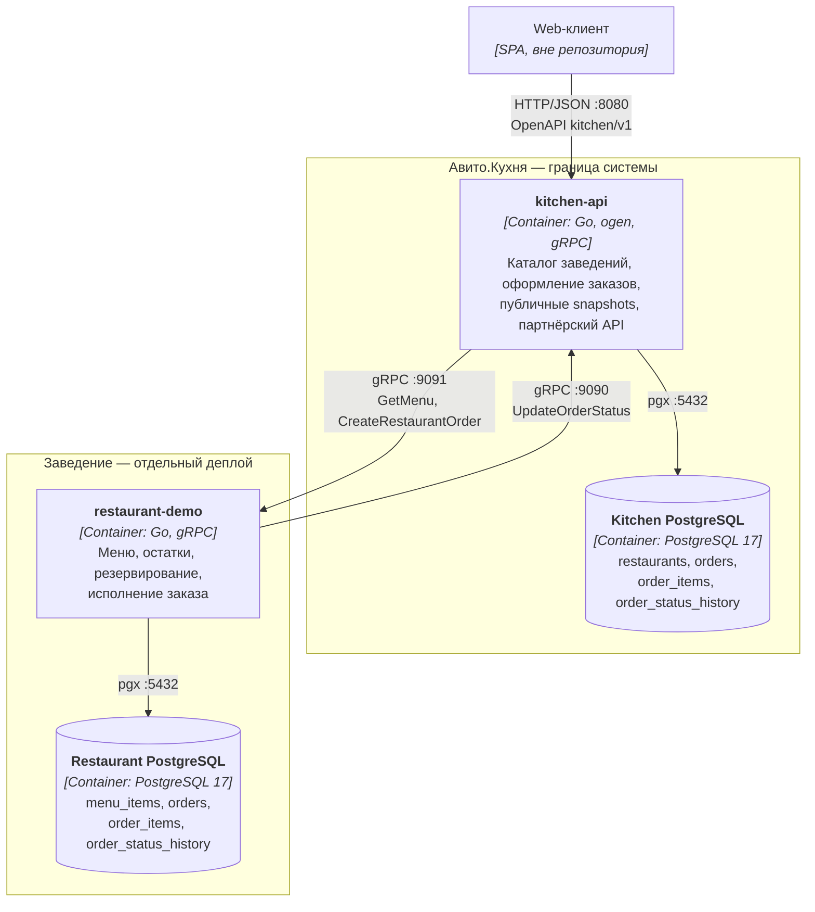
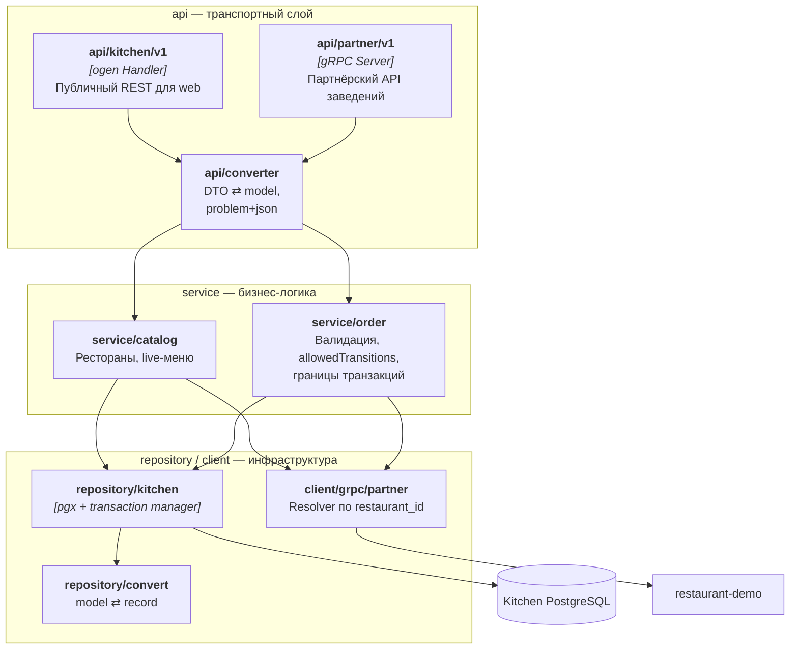
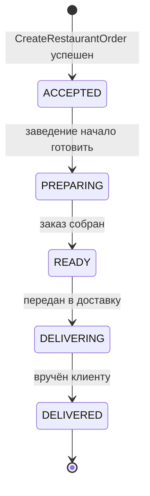

# Avito.Kitchen MVP

Сервис доставки еды: клиент выбирает заведение, собирает корзину из его живого меню и
оформляет заказ, а заведение исполняет этот заказ у себя и сообщает статус обратно.

В репозитории два сервиса, каждый со своей PostgreSQL:

- **`kitchen-api`** — сама площадка. Держит реестр заведений, оформляет заказы,
  хранит их публичные snapshots и историю статусов. Наружу отдаёт REST по OpenAPI
  для web-клиента, внутрь — приватный gRPC для заведений.
- **`restaurant-demo`** — пример подключённого заведения. Владеет меню, ценами,
  доступностью и остатками, принимает окончательное решение по заказу и ведёт его
  исполнение.

Оба поднимаются одной командой через Docker Compose.

## Быстрый запуск

Требования: Docker Compose v2. Для генерации кода также нужны Go 1.25+ и
[Task](https://taskfile.dev/).

```bash
cp .env.example .env
task up
```

После запуска:

- Kitchen REST: `http://localhost:8080`;
- Kitchen партнёрский gRPC: `localhost:9090`;
- Restaurant gRPC: `localhost:9091`;
- Kitchen PostgreSQL: `localhost:15432`;
- Restaurant PostgreSQL: `localhost:15433`;
- health-проверки Kitchen: `GET /healthz`, `GET /readyz`.

Основные команды:

```bash
task up          # поднять всё через Compose
task down        # остановить
task logs        # логи сервисов
task gen         # перегенерировать REST, gRPC и моки из контрактов
task migrate     # накатить миграции обеих баз
task lint        # go vet + golangci-lint + buf lint
```

## CJM

Два пути: клиента, который заказывает еду, и заведения, которое этот заказ исполняет.

### CJM клиента



Болевая точка — шаг «блюдо разобрали, пока он выбирал». Она решена не блокировкой
корзины, а `observed_version`: при чтении меню клиент получает `version` каждой позиции
и возвращает её при оформлении. Если меню успело измениться, заказ не создаётся
частично — вся проверка откатывается, и Kitchen отвечает `409 MENU_CHANGED`.
Клиент перечитывает меню и пересобирает корзину.

Разбивки по конкретным позициям в `409` нет: ответ сообщает только факт конфликта.
Что именно изменилось, клиент узнаёт из повторного `GET .../menu` — там уже видны
актуальные цены, `is_available` и новые `version`. Это осознанное упрощение MVP,
см. «Осознанные упрощения».



### CJM заведения



Заведение никогда не пишет в базу Kitchen напрямую: оно меняет статус у себя и
сообщает о нём партнёрским вызовом. Kitchen остаётся единственным владельцем своего
состояния и сам проверяет допустимость перехода.



## Архитектура

Диаграммы описаны на Mermaid и рендерятся GitHub без внешних инструментов, поэтому
исходник диаграммы и её отображение всегда совпадают.

### C4 Level 1 — контекст



### C4 Level 2 — контейнеры



Оба направления приватные и синхронные. Kitchen одновременно REST-сервер для web,
gRPC-клиент заведения и gRPC-сервер партнёрского API; restaurant-demo — gRPC-сервер
для Kitchen и gRPC-клиент его партнёрского API.

Меню целиком принадлежит заведению: Kitchen не хранит `menu_items` и ничего не
синхронизирует, а на каждый запрос меню ходит в restaurant-demo живым вызовом
`GetMenu`. UUID и `version` позиции тоже принадлежат заведению, поэтому отдельный
`external_id` между сервисами не нужен. Цена этого решения — доступность меню зависит
от заведения; что с этим делать при росте, описано в «Масштабировании».

### C4 Level 3 — компоненты kitchen-api



## Инженерные решения

Что сделано осознанно и где это видно в коде.

### Чистая трёхслойная архитектура

В каждом сервисе зависимости идут строго в одну сторону: `api` и `client` → `service`
→ `repository`. Транспорт не знает про SQL, repository не знает про HTTP и gRPC, а
`service` не импортирует ни ogen-, ни protobuf-типы.

Интерфейсы объявлены на стороне потребителя — `service/order/deps.go`,
`api/kitchen/v1/deps.go`, `service/catalog/deps.go`. Нижние слои не диктуют верхним
свои контракты, и каждый слой описывает ровно те методы, которые ему нужны. Из этих же
файлов генерируются заглушки (`task gen:mocks`), поэтому любую зависимость можно
подменить, не трогая продакшн-код.

### У каждого слоя своя модель

Их три, и они не пересекаются:

| Слой | Тип | Откуда берётся |
|---|---|---|
| транспорт | ogen DTO, protobuf-сообщения | сгенерированы из OpenAPI и `.proto` |
| домен | `internal/model` | написаны руками, ни от чего не зависят |
| хранилище | `internal/repository/record` | повторяют колонки таблиц |

Границы держат конвертеры: `api/converter` переводит DTO ⇄ model,
`repository/convert` — model ⇄ record. Ни один слой не видит типы соседа через голову
конвертера, поэтому переименование колонки не протекает в JSON, а правка OpenAPI не
ломает SQL. Доменная модель остаётся тем единственным местом, где описана предметная
область, а не форма запроса или таблицы.

### Транзакции открывает только service

Repository не начинает и не коммитит транзакцию — он выполняет один запрос в том
соединении, которое ему дали. Границу задаёт service, потому что только он знает,
какие изменения обязаны примениться вместе.

Границ ровно две, обе многошаговые:

- **Kitchen** — `orders` + `order_items` + `order_status_history` одной транзакцией
  (`service/order/create.go`, `service/order/update_status.go`);
- **restaurant-demo** — `SELECT menu_items FOR UPDATE` → проверка версии, доступности
  и остатка → списание остатка → `orders` + `order_items` + `order_status_history`
  (`service/restaurant/create_order.go`). Блокировка строк меню на весь этот путь и
  делает проверку корзины атомарной: две параллельные попытки забрать последнюю
  порцию не могут обе пройти.

### Менеджер транзакций от Авито

Используется [`github.com/avito-tech/go-transaction-manager`](https://github.com/avito-tech/go-transaction-manager):
service вызывает `txManager.Do(ctx, func(txCtx context.Context) error { ... })`, а
repository внутри достаёт соединение через `r.getter.DefaultTrOrDB(ctx, r.pool)`.

Что это даёт по сравнению с ручной передачей `pgx.Tx` параметром:

- **транзакция едет в `context`, а не в сигнатурах.** Методы repository не тащат
  `pgx.Tx` и не раздваиваются на «версию в транзакции» и «версию без неё»;
- **`DefaultTrOrDB` возвращает либо активную транзакцию из контекста, либо пул**, если
  транзакции нет. Один и тот же `GetOrder` одинаково работает внутри `Do` и снаружи;
- **commit и rollback привязаны к возврату из функции**: вернулась ошибка — rollback,
  вернулся `nil` — commit. Потерять `defer tx.Rollback()`, закоммитить дважды или
  выйти из функции с открытой транзакцией здесь негде;
- **вложенные `Do` не открывают вторую транзакцию**, а разворачиваются в savepoint'ы,
  поэтому service может вызвать другой service без риска получить «transaction already
  begun»;
- **service не зависит от библиотеки**: в `deps.go` объявлен свой интерфейс `TxManager`
  из одного метода `Do`, поэтому замена реализации не заденет бизнес-логику.

Обратная сторона, про которую стоит помнить: транзакция становится неявной. Если
repository вызвать вне `Do`, он молча отработает на пуле вместо транзакции и ошибки не
будет — компилятор такую потерю не ловит, её ловит только внимательность к тому, где
проходит граница.

### Ошибки доменные, транспорт только маппит

Внутри сервисов ходит `errs.Error` с `Kind` и стабильным `Code`. В HTTP-код и
gRPC-статус он превращается ровно на границе: `api/kitchen/v1/errors.go` и
`api/partner/v1/errors.go`. Наружу уходит `application/problem+json` со стабильным
машинным `code`, а тексты драйвера и SQL-ошибки не покидают repository — они
заворачиваются в `repositoryError` и логируются, но не отдаются клиенту.

### Контракты — источник истины, код генерируется

REST описан в `shared/api/kitchen/v1/`, межсервисный gRPC — в
`shared/proto/partner/v1/partner.proto`. Серверы, клиенты и DTO генерируются из них
(`ogen`, `buf`), руками не правятся. Схема не может разойтись с кодом, потому что код
из неё и получается.

### Инварианты продублированы в базе

То, что обязано быть верным всегда, не оставлено на совесть кода: `CHECK` на непустые
поля, формат валюты и диапазон количества, составной первичный ключ
`order_items (order_id, menu_item_id)` вместо суррогатного `id`, `GENERATED ALWAYS` для
`line_total_minor`, `CHECK (is_active OR NOT accepting_orders)` на реестре заведений.
Даже прямой `INSERT` мимо приложения не сможет создать некорректную строку.

### Деньги и статическая проверка

Все суммы — целые в минимальных единицах валюты (590 ₽ хранятся как `59000`), валюта
лежит рядом с ценой. Плавающей точки в денежных путях нет вообще; переполнение при
умножении цены на количество проверяется явно.

Статический анализ настроен в `.golangci.yml` и запускается как `task lint` вместе с
`go vet` и `buf lint`.

## Контракты

- REST-исходники: `shared/api/kitchen/v1/`;
- ogen-код: `shared/pkg/openapi/kitchen/v1/`;
- Protobuf-исходник: `shared/proto/partner/v1/partner.proto`;
- protobuf/gRPC-код: `shared/pkg/proto/partner/v1/`;
- генерация: `task gen`.

### Public REST

| Метод | Путь | Назначение |
|---|---|---|
| `GET` | `/api/v1/restaurants` | Получить активные заведения |
| `GET` | `/api/v1/restaurants/{restaurantId}/menu` | Получить live-меню через restaurant-demo |
| `POST` | `/api/v1/orders` | Атомарно проверить корзину и создать заказ |
| `GET` | `/api/v1/orders/{orderId}` | Получить сохранённый snapshot заказа |
| `GET` | `/healthz` | Проверить, что процесс работает |
| `GET` | `/readyz` | Проверить готовность Kitchen и его PostgreSQL |

Заказ относится к одному заведению и содержит от 1 до 100 уникальных позиций по
1–99 единиц каждой. Меню возвращает все активные блюда, включая временно недоступные:
клиент видит их с `is_available: false` и понимает, почему не может их заказать.

Ошибки приходят как `application/problem+json`: валидация — `400`, не найдено — `404`,
конфликт меню — `409`, restaurant-demo недоступен — `503`, всё прочее — `500`.

### Private gRPC

Оба направления интеграции описаны в одном версионированном Protobuf-контракте:

| Сервис и RPC | Кто вызывает | Назначение |
|---|---|---|
| `RestaurantService.GetMenu` | Kitchen | Прочитать актуальное меню из PostgreSQL заведения |
| `RestaurantService.CreateRestaurantOrder` | Kitchen | Атомарно проверить, зарезервировать позиции и создать заказ |
| `RestaurantService.UpdateRestaurantOrderStatus` | система заведения / demo-вызов | Изменить локальный статус и синхронно уведомить Kitchen |
| `KitchenPartnerService.UpdateOrderStatus` | restaurant-demo | Сохранить новый статус и историю в Kitchen |

`KitchenPartnerService` закрыт API key-аутентификацией. Restaurant-demo передаёт ключ в
gRPC metadata `x-api-key`; unary interceptor Kitchen сопоставляет ключ с UUID заведения.
UUID из тела запроса дополнительно сверяется с аутентифицированным, поэтому подставить
чужой идентификатор недостаточно. Для локального Compose ключ задаётся переменной
`RESTAURANT_API_KEY`, а Kitchen получает отображение `restaurant_id=key` через
`RESTAURANT_API_KEYS`.

## Схема БД

### Состояния заказа



Переходы проверяются в service-слоях обеих систем. Успешно созданный заказ сразу
получает `ACCEPTED` — отдельного подтверждения с polling нет. Если заведение не может
принять заказ, создание атомарно отклоняется и заказ не сохраняется нигде.

### Таблицы

Kitchen PostgreSQL:

- `restaurants` — реестр доступных заведений;
- `orders` — публичное состояние заказа;
- `order_items` — snapshots UUID, названия, цены и количества;
- `order_status_history` — история статусов.

Restaurant PostgreSQL:

- `menu_items` — меню, доступность, версия и `available_quantity`;
- `orders` — заказ, принятый заведением;
- `order_items` — snapshots заведения;
- `order_status_history` — история исполнения.


### Ключевые решения по схеме

- `KITCHEN_ORDERS.id` и `RESTAURANT_ORDERS.id` — один и тот же UUID, сгенерированный
  Kitchen. Он же в будущем станет ключом идемпотентности.
- Физического внешнего ключа между `Kitchen.order_items.menu_item_id` и меню заведения
  нет: это межсервисная ссылка, целостность обеспечивается протоколом, а не БД.
- `order_items` в обеих базах — snapshots названия и цены на момент оформления.
  Последующее изменение меню не переписывает историю заказа.
- `line_total_minor` — генерируемая колонка, рассинхрон с `unit_price_minor * quantity`
  невозможен по построению.
- Первичный ключ `order_items` — составной `(order_id, menu_item_id)`: суррогатный `id`
  не нёс смысла, а уникальность пары и так требовалась.
- Один экземпляр `restaurant-demo` представляет одно заведение, поэтому локальная
  таблица `restaurants` и повторяющиеся `restaurant_id` в его таблицах не нужны.

Миграции лежат в `db/migrations/kitchen` и `db/migrations/restaurant`, накатываются
goose и запускаются в Compose до старта сервисов.

## Транзакции и согласованность

Restaurant выполняет в одной локальной транзакции:

```text
SELECT menu_items FOR UPDATE
-> validate version/availability/quantity
-> decrement available_quantity
-> INSERT orders
-> INSERT order_items
-> INSERT order_status_history(ACCEPTED)
```

Kitchen после успешного gRPC-ответа отдельной локальной транзакцией записывает свой
`order + items + history`. При смене статуса restaurant-demo сначала атомарно меняет
свой `order + history`, затем синхронно вызывает Kitchen.

Общей ACID-транзакции между двумя PostgreSQL нет, и это главный компромисс системы.
Поэтому возможны orphan-заказы после создания (заведение списало остаток, Kitchen не
успел записать snapshot) или временное расхождение статусов при сбое между локальным
commit и внешним вызовом. Чем это лечится при росте — в «Масштабировании».

## Осознанные упрощения

Решения, принятые ради объёма MVP. Каждое видно в коде или схеме, поэтому описано явно.

**Отказ заведения не сохраняется как состояние заказа.** Если позиции разобрали или
изменилась версия меню, `CreateRestaurantOrder` откатывает транзакцию, заказ не
создаётся ни в одной из баз, а клиент получает `409 MENU_CHANGED`. Отдельного статуса
`REJECTED` у сохранённого заказа нет.

В Kitchen зарезервированы ещё два состояния — `PENDING_CONFIRMATION` для будущего
асинхронного подтверждения через outbox и `REJECTED` для отказа уже принятого заказа.
Они остаются в доменной модели, OpenAPI, enum базы и заготовке машины переходов, но
текущий поток их не устанавливает: без outbox первое недостижимо, а второе требует
компенсирующего возврата `available_quantity`, иначе отклонённый заказ навсегда списал
бы продукты со склада.

Для этого будущего расширения также сохранены:

- значения `PENDING_CONFIRMATION` и `REJECTED` в enum `order_status` — PostgreSQL не
  умеет `ALTER TYPE ... DROP VALUE`, а пересоздавать тип через `ALTER TABLE ... USING`
  ради двух неиспользуемых меток дороже, чем оставить их;
- колонка `orders.rejection_reason`, констрейнт `orders_rejection_reason_consistent` и
  колонка `order_status_history.reason` — они не заполняются и ждут появления отмены
  заказа с возвратом резерва.

**`409` не перечисляет конфликтные позиции.** Ответ содержит только код `MENU_CHANGED`
и человекочитаемый `detail`. Restaurant-demo прекращает проверку на первом же
несовпадении и не собирает полный список расхождений, поэтому Kitchen нечего было бы
передать клиенту. Чтобы контракт не обещал больше, чем отдаёт код, схема ошибки не
содержит поля `items`, а восстановление строится на повторном чтении меню.

**Согласованность между двумя базами.** Общей ACID-транзакции нет, окна рассогласования
описаны выше и приняты как известный trade-off.

**Синхронная доставка статусов.** Заведение вызывает Kitchen напрямую и получает ошибку,
если вызов не прошёл. Повтор того же перехода идемпотентен, но автоматического retry нет.

**Маршрутизация заведений живёт в конфигурации.** Соответствие
`restaurant_id → gRPC-адрес` и `restaurant_id → API key` задаётся переменными окружения
`RESTAURANT_GRPC_ROUTES` и `RESTAURANT_API_KEYS`, соединения поднимаются на старте.
Для закрытого списка заведений в MVP этого достаточно.

## Масштабирование

Задание прямо говорит, что после MVP решение придётся масштабировать. Ниже — что
упрётся первым и что с этим делать, в порядке того, насколько рано это заболит.

**1. Подключение заведений перестанет помещаться в конфиг.** Сейчас адрес и API key
каждого заведения лежат в переменных окружения, а `Resolver` строит все gRPC-соединения
на старте процесса: добавить заведение — значит перевыкатить Kitchen. Нужно перенести
адрес интеграции и хэш ключа в таблицу `restaurants`, поднимать соединения лениво и
класть их в пул с health-check, а ключи научиться ротировать без рестарта. Место в коде
изолировано — `client/grpc/partner/resolver.go` и `config`.

**2. Меню станет узким местом раньше всего остального.** `GET /menu` — синхронный поход
в заведение на каждый запрос, а меню читают на порядки чаще, чем заказывают. Заведение
становится и точкой отказа, и потолком RPS всей витрины. Решение — кэш меню в Kitchen
(Redis или локальный с коротким TTL) с инвалидацией по `version`, при этом
`observed_version` остаётся источником правды на записи: витрину можно отдавать чуть
устаревшей, потому что финальную проверку всё равно делает заведение под `FOR UPDATE`.
Это ровно то, ради чего меню изначально не дублируется в Kitchen.

**3. Доставка статусов потеряет события.** Заведение вызывает Kitchen синхронно; если
Kitchen недоступен, статус разъезжается и починить его некому. Нужен transactional
outbox на стороне заведения: статус и запись в outbox пишутся одной транзакцией, а
отправку с ретраями и backoff делает отдельный воркер. Схема к этому уже готова —
`PENDING_CONFIRMATION` зарезервирован, история статусов ведётся отдельной таблицей.

**4. Повторный `POST /orders` создаст второй заказ.** `order_id` генерирует Kitchen на
каждый вызов, поэтому ретрай клиента или таймаут на балансировщике дадут дубль с
дважды списанным остатком. Нужен `Idempotency-Key` в запросе, уникальный индекс на него
и возврат уже созданного заказа при повторе. UUID заказа общий для обеих баз — он и
станет ключом.

**5. Распределённая транзакция потребует компенсаций.** Заведение списало остаток,
Kitchen не записал snapshot — заказ существует у одного и не существует у другого.
Нужна явная saga: recovery job, который сверяет заказы обеих систем, и компенсирующая
операция возврата `available_quantity`. Под неё уже оставлены `REJECTED` и
`rejection_reason`.

**6. Списки упрутся в размер.** `GET /api/v1/restaurants` возвращает все активные
заведения без лимита, у заказов нет списочного метода вообще. Нужна keyset-пагинация
(индексы под сортировку `(name, id)` и `(created_at, id)` уже есть) и фильтры по
геопозиции и категории, когда заведений станет больше сотни.

**7. Наблюдаемость.** Сейчас есть только структурные логи. При двух и более сетевых
прыжках на запрос нужен сквозной trace id через REST и gRPC, метрики по каждому RPC и
алерты на расхождение статусов между базами — иначе окна рассогласования из предыдущего
пункта никто не заметит.

**Что масштабируется без переделки.** Оба сервиса stateless — Kitchen можно множить
горизонтально за балансировщиком, состояние живёт только в PostgreSQL. Заведения
изолированы: их базы независимы, отказ одного заведения не роняет витрину остальных, а
новое заведение — это новый экземпляр со своим контрактом, а не миграция общей схемы.
Заказы естественно шардируются по `restaurant_id`, а денежные суммы в целых минимальных
единицах не потребуют пересчёта при смене валюты.
