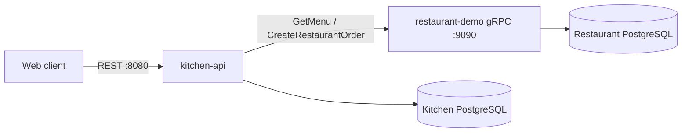
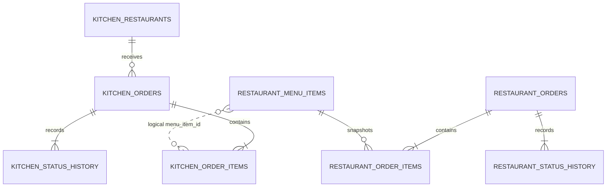

# Avito.Kitchen MVP

Система заказа еды с публичным REST/OpenAPI контрактом и приватным gRPC-контрактом между сервисами.

- `kitchen-api` хранит реестр ресторанов и публичные snapshots заказов.
- `restaurant-demo` владеет меню, доступностью, остатками и ресторанными заказами.
- Kitchen не хранит `menu_items` и не синхронизирует меню.

Основной поток:

```text
Web -> REST Kitchen -> gRPC RestaurantDemo -> PostgreSQL ресторана
                         |
                         +-> при успехе Kitchen сохраняет snapshot заказа
                             в своей PostgreSQL
```

## Быстрый запуск

Требования: Docker Compose v2. Для генерации и тестов также нужны Go 1.25+ и [Task](https://taskfile.dev/).

```bash
cp .env.example .env
task up
```

После запуска:

- Kitchen REST: `http://localhost:8080`;
- Restaurant gRPC: `localhost:9090`;
- Kitchen PostgreSQL: `localhost:15432`;
- Restaurant PostgreSQL: `localhost:15433`;
- Kitchen health: `GET /healthz`, `GET /readyz`.

Основные команды:

```bash
task gen
task db:up
task migrate
task build
task up
task logs
task test
task test:integration
task test:e2e
task lint
task down
```

## Бизнес-правила

- Kitchen получает меню live-вызовом `RestaurantService.GetMenu`.
- Restaurant возвращает активные блюда, включая временно недоступные; клиент видит `is_available`.
- UUID и `version` блюда принадлежат restaurant-demo. Отдельный `external_id` между сервисами не используется.
- Заказ относится к одному ресторану, содержит 1–100 уникальных блюд и 1–99 единиц каждого блюда.
- Web возвращает `observed_version`, увиденную при чтении меню.
- `CreateRestaurantOrder` в одной транзакции блокирует блюда через `FOR UPDATE`, проверяет существование, версию, доступность, валюту и остаток, уменьшает остаток и записывает ресторанный заказ.
- Если хотя бы одна проверка не прошла, вся транзакция откатывается, а Kitchen возвращает `409 MENU_CHANGED`.
- При успехе restaurant-demo возвращает авторитетные snapshots названий и цен. Kitchen сохраняет их в своих `orders/order_items`; дальнейшее изменение меню не изменяет заказ.
- Успешно созданный заказ сразу имеет статус `accepted`: отдельного polling-подтверждения больше нет.
- Денежные суммы хранятся целыми числами в минимальных единицах валюты.

Внутри каждого сервиса соблюдается направление `api/client -> service -> repository`. Transport DTO, domain model и PostgreSQL record разделены converter-пакетами. Транзакции открывает только service через Avito Transaction Manager; repository выбирает транзакцию из context посредством `trmpgx.DefaultCtxGetter`.

## Контракты

- REST-исходники: `shared/api/kitchen/v1/`;
- ogen-код: `shared/pkg/openapi/kitchen/v1/`;
- Protobuf-исходник: `shared/proto/partner/v1/partner.proto`;
- protobuf/gRPC-код: `shared/pkg/proto/partner/v1/`;
- генерация: `task gen`.

### Public REST

| Метод | Путь | Назначение |
|---|---|---|
| `GET` | `/api/v1/restaurants` | Получить активные рестораны |
| `GET` | `/api/v1/restaurants/{restaurantId}/menu` | Получить live-меню через restaurant-demo |
| `POST` | `/api/v1/orders` | Атомарно проверить корзину и создать заказ |
| `GET` | `/api/v1/orders/{orderId}` | Получить сохранённый snapshot заказа |
| `GET` | `/healthz` | Проверить, что процесс работает |
| `GET` | `/readyz` | Проверить готовность Kitchen и его PostgreSQL |

Ошибки возвращаются как `application/problem+json`: validation — `400`, not found — `404`, конфликт меню — `409`, недоступный restaurant-demo — `503`, неизвестная ошибка — `500`. SQL-ошибки наружу не передаются.

### Private gRPC

Restaurant-demo реализует единственный приватный сервис:

| RPC | Назначение |
|---|---|
| `GetMenu` | Прочитать актуальное меню из PostgreSQL ресторана |
| `CreateRestaurantOrder` | Атомарно проверить, зарезервировать блюда и создать заказ |

Kitchen использует сгенерированный `RestaurantServiceClient`.

## Архитектура



Kitchen PostgreSQL:

- `restaurants` — реестр доступных заведений и адрес интеграции на уровне конфигурации MVP;
- `orders` — публичное состояние заказа;
- `order_items` — snapshots UUID, названия, цены и количества;
- `order_status_history` — история статусов.

Restaurant PostgreSQL:

- `menu_items` — меню, доступность, версия и `available_quantity`;
- `orders` — заказ, принятый рестораном;
- `order_items` — ресторанные snapshots;
- `order_status_history` — история исполнения.

Между `Kitchen.order_items.menu_item_id` и Restaurant PostgreSQL физического внешнего ключа нет: это межсервисная ссылка.



Один экземпляр `restaurant-demo` представляет один ресторан, поэтому локальная
таблица `restaurants` и повторяющиеся `restaurant_id` в таблицах ресторана не
нужны. Валюта хранится вместе с ценами позиций меню и snapshot заказа, а не в
конфигурации сервиса.

## Транзакции и согласованность

Restaurant выполняет в одной локальной транзакции:

```text
SELECT menu_items FOR UPDATE
-> validate version/availability/quantity
-> decrement available_quantity
-> INSERT orders
-> INSERT order_items
-> INSERT order_status_history(accepted)
```

Kitchen после успешного gRPC-ответа отдельной локальной транзакцией записывает свой `order + items + history`. Общей ACID-транзакции между двумя PostgreSQL нет. Если restaurant-demo успел принять заказ, а Kitchen не сохранил snapshot, возможен orphan в базе ресторана. Для MVP это известный trade-off; production-улучшения — idempotency key/order ID, retry, recovery job и transactional outbox.

## CJM

```text
1. Клиент открывает рестораны
   REST Kitchen -> Kitchen.restaurants

2. Клиент открывает меню
   REST Kitchen -> gRPC GetMenu -> Restaurant.menu_items

3. Клиент отправляет корзину с menu_item_id и observed_version
   REST Kitchen -> gRPC CreateRestaurantOrder
   -> Restaurant блокирует menu_items и проверяет остаток

4a. Конфликт
    Restaurant transaction rollback -> gRPC FailedPrecondition -> REST 409

4b. Успех
    Restaurant записывает orders/order_items/history и уменьшает остаток
    -> Kitchen записывает свой snapshot orders/order_items/history
    -> REST 201 accepted

5. Клиент читает заказ
   REST Kitchen -> Kitchen.orders + Kitchen.order_items
```

## Тестирование

- Unit: валидация и отсутствие резервирования при конфликте версии.
- Integration: реальные PostgreSQL и транзакции обоих сервисов.
- E2E: live-меню, успешное создание заказа через gRPC и `409` при устаревшей версии.

```bash
task up
task test
task test:integration
task test:e2e
```

## Вне текущего MVP

API keys/mTLS, access token заказа, полноценная идемпотентность, retries/backoff, автоматический recovery, transactional outbox, отмена с возвратом резерва и асинхронная синхронизация последующих статусов.
