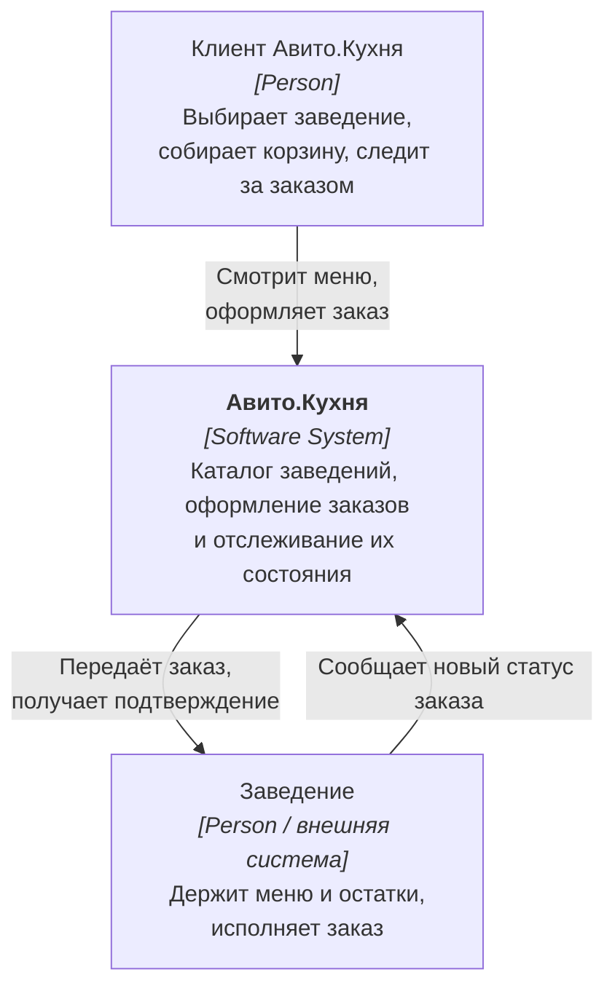
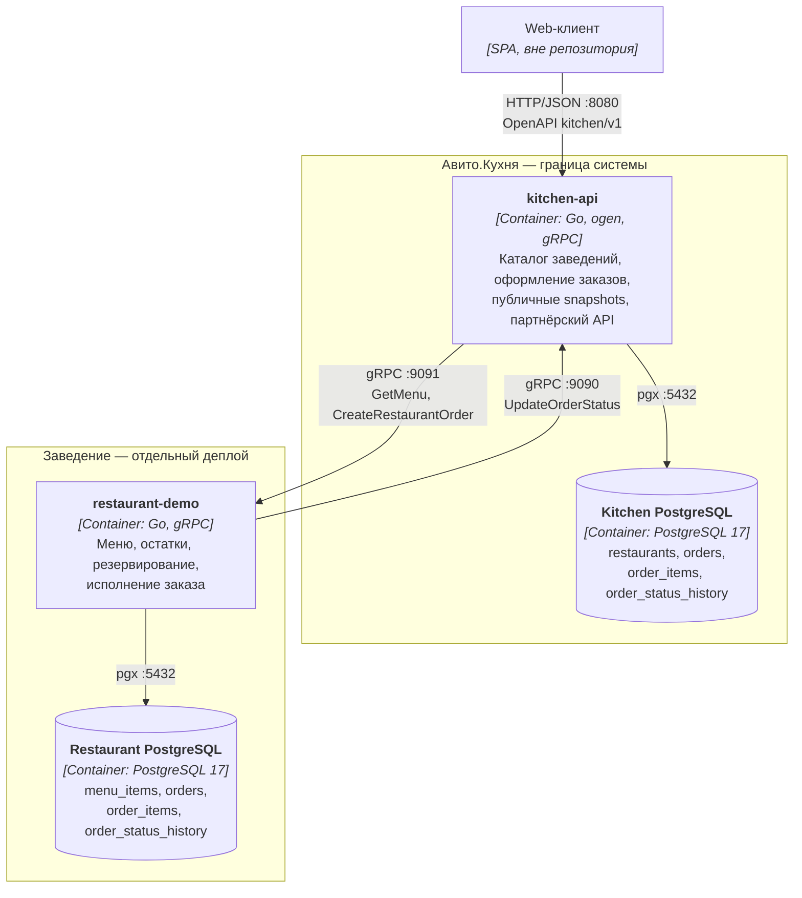
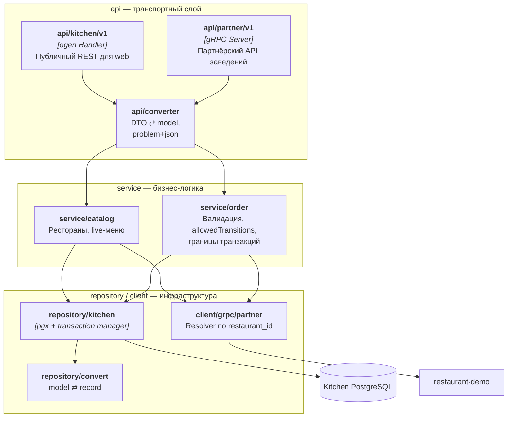
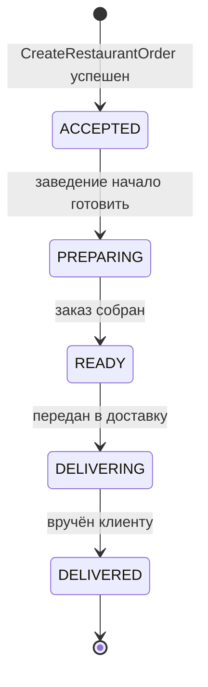
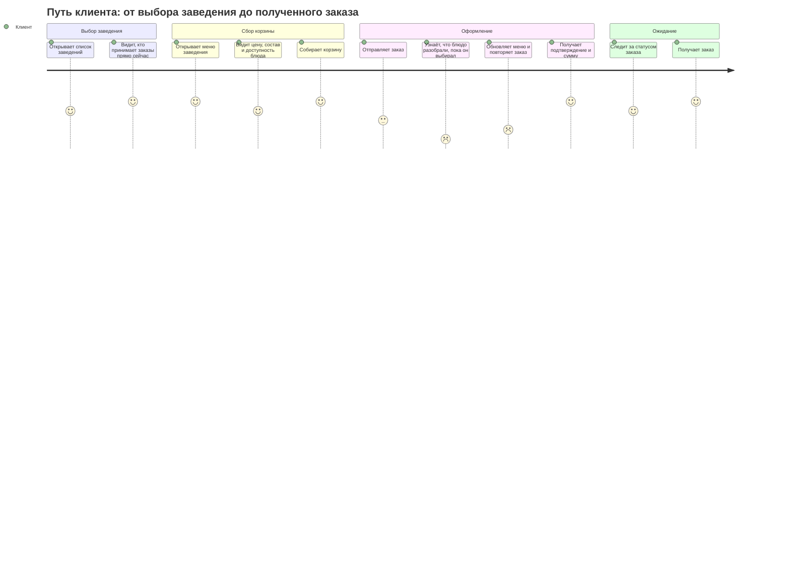
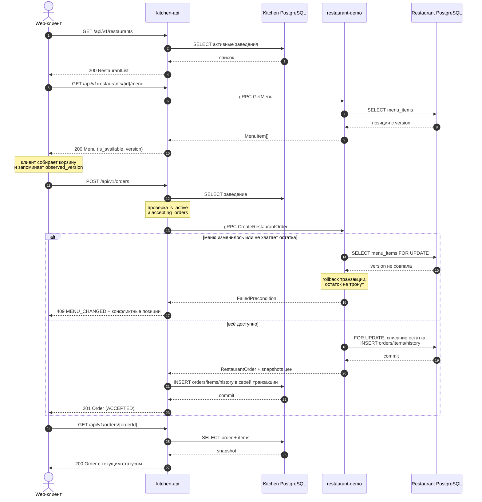
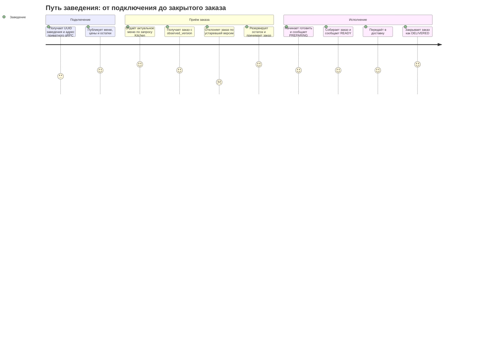
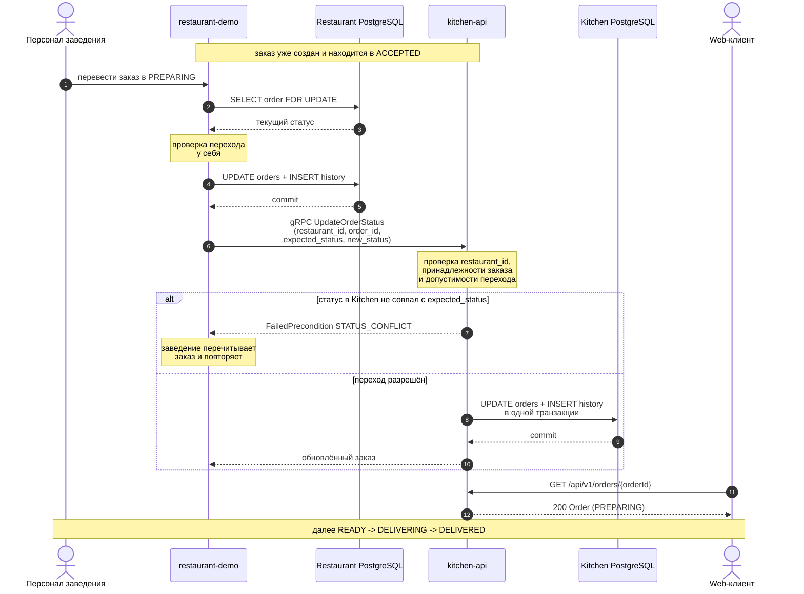

# Avito.Kitchen MVP

Система заказа еды с публичным REST/OpenAPI контрактом и приватным gRPC-контрактом между сервисами.

- `kitchen-api` хранит реестр ресторанов и публичные snapshots заказов.
- `restaurant-demo` владеет меню, доступностью, остатками и ресторанными заказами.
- Kitchen не хранит `menu_items` и не синхронизирует меню.

Основные потоки:

```text
Оформление заказа
Web -> REST Kitchen -> gRPC RestaurantDemo -> PostgreSQL ресторана
                         |
                         +-> при успехе Kitchen сохраняет snapshot заказа
                             в своей PostgreSQL

Исполнение заказа
Заведение -> gRPC RestaurantDemo -> PostgreSQL ресторана
                         |
                         +-> синхронный gRPC в Kitchen обновляет
                             публичный статус и его историю
```

## Быстрый запуск

Требования: Docker Compose v2. Для генерации и тестов также нужны Go 1.25+ и [Task](https://taskfile.dev/).

```bash
cp .env.example .env
task up
```

После запуска:

- Kitchen REST: `http://localhost:8080`;
- Kitchen партнёрский gRPC: `localhost:9090`;
- Restaurant gRPC: `localhost:9091`;
- Kitchen PostgreSQL: `localhost:15432`;
- Restaurant PostgreSQL: `localhost:15433`;
- Kitchen health: `GET /healthz`, `GET /readyz`.

Основные команды:

```bash
task gen
task db:up
task migrate
task build
task up
task logs
task test
task test:integration
task test:e2e
task lint
task down
```

## Бизнес-правила

- Kitchen получает меню live-вызовом `RestaurantService.GetMenu`.
- Restaurant возвращает активные блюда, включая временно недоступные; клиент видит `is_available`.
- UUID и `version` блюда принадлежат restaurant-demo. Отдельный `external_id` между сервисами не используется.
- Заказ относится к одному ресторану, содержит 1–100 уникальных блюд и 1–99 единиц каждого блюда.
- Web возвращает `observed_version`, увиденную при чтении меню.
- `CreateRestaurantOrder` в одной транзакции блокирует блюда через `FOR UPDATE`, проверяет существование, версию, доступность, валюту и остаток, уменьшает остаток и записывает ресторанный заказ.
- Если хотя бы одна проверка не прошла, вся транзакция откатывается, а Kitchen возвращает `409 MENU_CHANGED`.
- При успехе restaurant-demo возвращает авторитетные snapshots названий и цен. Kitchen сохраняет их в своих `orders/order_items`; дальнейшее изменение меню не изменяет заказ.
- Успешно созданный заказ сразу имеет статус `ACCEPTED`: отдельного polling-подтверждения больше нет.
- Денежные суммы хранятся целыми числами в минимальных единицах валюты.

Внутри каждого сервиса соблюдается направление `api/client -> service -> repository`. Transport DTO, domain model и PostgreSQL record разделены converter-пакетами. Транзакции открывает только service через Avito Transaction Manager; repository выбирает транзакцию из context посредством `trmpgx.DefaultCtxGetter`.

## Контракты

- REST-исходники: `shared/api/kitchen/v1/`;
- ogen-код: `shared/pkg/openapi/kitchen/v1/`;
- Protobuf-исходник: `shared/proto/partner/v1/partner.proto`;
- protobuf/gRPC-код: `shared/pkg/proto/partner/v1/`;
- генерация: `task gen`.

### Public REST

| Метод | Путь | Назначение |
|---|---|---|
| `GET` | `/api/v1/restaurants` | Получить активные рестораны |
| `GET` | `/api/v1/restaurants/{restaurantId}/menu` | Получить live-меню через restaurant-demo |
| `POST` | `/api/v1/orders` | Атомарно проверить корзину и создать заказ |
| `GET` | `/api/v1/orders/{orderId}` | Получить сохранённый snapshot заказа |
| `GET` | `/healthz` | Проверить, что процесс работает |
| `GET` | `/readyz` | Проверить готовность Kitchen и его PostgreSQL |

Ошибки возвращаются как `application/problem+json`: validation — `400`, not found — `404`, конфликт меню — `409`, недоступный restaurant-demo — `503`, неизвестная ошибка — `500`. SQL-ошибки наружу не передаются.

### Private gRPC

Оба направления интеграции описаны в одном версионированном Protobuf-контракте:

| Сервис и RPC | Кто вызывает | Назначение |
|---|---|---|
| `RestaurantService.GetMenu` | Kitchen | Прочитать актуальное меню из PostgreSQL ресторана |
| `RestaurantService.CreateRestaurantOrder` | Kitchen | Атомарно проверить, зарезервировать блюда и создать заказ |
| `RestaurantService.UpdateRestaurantOrderStatus` | система ресторана / demo-вызов | Изменить локальный статус и синхронно уведомить Kitchen |
| `KitchenPartnerService.UpdateOrderStatus` | restaurant-demo | Сохранить новый статус и history в Kitchen |

Kitchen использует сгенерированный `RestaurantServiceClient`, а restaurant-demo —
`KitchenPartnerServiceClient`.

`KitchenPartnerService` закрыт API key-аутентификацией. Restaurant-demo передаёт ключ
в gRPC metadata `x-api-key`; unary interceptor Kitchen сопоставляет ключ с UUID
заведения. UUID из тела запроса дополнительно сверяется с аутентифицированным UUID,
поэтому подставить идентификатор другого ресторана недостаточно. Для локального Compose
ключ задаётся переменной `RESTAURANT_API_KEY`, а Kitchen получает отображение
`restaurant_id=key` через `RESTAURANT_API_KEYS`.

## Архитектура

Диаграммы описаны на Mermaid и рендерятся GitHub без внешних инструментов, поэтому
исходник диаграммы и её отображение всегда совпадают.

### C4 Level 1 — контекст



### C4 Level 2 — контейнеры



Оба направления приватные и синхронные. Kitchen одновременно REST-сервер для web,
gRPC-клиент заведения и gRPC-сервер партнёрского API; restaurant-demo — gRPC-сервер
для Kitchen и gRPC-клиент его партнёрского API.

### C4 Level 3 — компоненты kitchen-api



Направление зависимостей всегда `api/client -> service -> repository`. Transport DTO,
domain model и PostgreSQL record изолированы converter-пакетами: `api/converter`
переводит DTO ⇄ model, `repository/convert` — model ⇄ record. Ни один слой не видит
типы соседа через голову конвертера.

### Состояния заказа



Переходы проверяются в service-слоях обеих систем. Если ресторан не может создать
заказ из-за отсутствия блюда, количества или изменения версии меню, создание
атомарно отклоняется и public REST возвращает `409`; отдельный заказ `REJECTED`
в текущем синхронном MVP не сохраняется.

### Схема данных

Kitchen PostgreSQL:

- `restaurants` — реестр доступных заведений и адрес интеграции на уровне конфигурации MVP;
- `orders` — публичное состояние заказа;
- `order_items` — snapshots UUID, названия, цены и количества;
- `order_status_history` — история статусов.

Restaurant PostgreSQL:

- `menu_items` — меню, доступность, версия и `available_quantity`;
- `orders` — заказ, принятый рестораном;
- `order_items` — ресторанные snapshots;
- `order_status_history` — история исполнения.

Между `Kitchen.order_items.menu_item_id` и Restaurant PostgreSQL физического внешнего ключа нет: это межсервисная ссылка.


Ключевые решения по схеме:

- `KITCHEN_ORDERS.id` и `RESTAURANT_ORDERS.id` — один и тот же UUID, сгенерированный
  Kitchen. В будущем его можно использовать как ключ идемпотентности; полноценная
  обработка повторной отправки в MVP не реализована.
- `order_items` в обеих базах — snapshots названия и цены на момент оформления.
  Последующее изменение меню не переписывает историю заказа.
- `line_total_minor` в обеих базах — генерируемая колонка, рассинхрон с
  `unit_price_minor * quantity` невозможен по построению.
- Первичный ключ `order_items` — составной `(order_id, menu_item_id)`: суррогатный
  `id` не нёс смысла, а уникальность пары и так требовалась.
- Деньги везде целые в минимальных единицах валюты, валюта хранится рядом с ценой.

Один экземпляр `restaurant-demo` представляет один ресторан, поэтому локальная
таблица `restaurants` и повторяющиеся `restaurant_id` в таблицах ресторана не
нужны. Валюта хранится вместе с ценами позиций меню и snapshot заказа, а не в
конфигурации сервиса.

## Транзакции и согласованность

Restaurant выполняет в одной локальной транзакции:

```text
SELECT menu_items FOR UPDATE
-> validate version/availability/quantity
-> decrement available_quantity
-> INSERT orders
-> INSERT order_items
-> INSERT order_status_history(ACCEPTED)
```

Kitchen после успешного gRPC-ответа отдельной локальной транзакцией записывает свой
`order + items + history`. При смене статуса restaurant-demo сначала атомарно меняет
свой `order + history`, затем синхронно вызывает Kitchen. Общей ACID-транзакции между
двумя PostgreSQL нет. Поэтому возможны orphan после создания или временное расхождение
статусов при сбое между локальным commit и внешним вызовом. Для MVP это известный
trade-off; production-улучшения — idempotency key/order ID, retry, recovery job и
transactional outbox.

## CJM

Два пути: клиента, который заказывает еду, и заведения, которое этот заказ исполняет.

### CJM клиента



Болевая точка — шаг «блюдо разобрали, пока он выбирал». Она решена не блокировкой
корзины, а `observed_version`: клиент присылает версию меню, которую видел, и Kitchen
отвечает `409 MENU_CHANGED` с перечнем конфликтных позиций, их актуальными ценами и
доступностью. Клиент видит именно то, что изменилось, а не абстрактную ошибку.



### CJM заведения



Заведение никогда не пишет в базу Kitchen напрямую: оно меняет статус у себя и
сообщает о нём партнёрским вызовом. Kitchen остаётся единственным владельцем своего
состояния и сам проверяет допустимость перехода.



## Тестирование

- Unit: валидация и отсутствие резервирования при конфликте версии.
- Integration: реальные PostgreSQL и транзакции обоих сервисов.
- E2E: live-меню, успешное создание заказа через gRPC и `409` при устаревшей версии.

```bash
task up
task test
task test:integration
task test:e2e
```

## Осознанные упрощения

Решения, принятые ради объёма MVP. Каждое видно в коде или схеме, поэтому описано явно.

**Отказ ресторана не сохраняется как состояние заказа.** Если позиции разобрали или
изменилась версия меню, `CreateRestaurantOrder` откатывает транзакцию, заказ не
создаётся ни в одной из баз, а клиент получает `409 MENU_CHANGED`. Отдельного статуса
`REJECTED` у сохранённого заказа нет.

В Kitchen зарезервированы ещё два состояния — `PENDING_CONFIRMATION` для будущего
асинхронного подтверждения через outbox и `REJECTED` для отказа уже принятого заказа.
Они пока остаются в доменной модели, OpenAPI, enum базы и заготовке машины переходов,
но текущий runtime-поток их не устанавливает: без outbox первое недостижимо, а второе
требует компенсирующего возврата `available_quantity`, иначе отклонённый заказ навсегда
списал бы продукты со склада.

Для этого будущего расширения также сохранены:

- значения `PENDING_CONFIRMATION` и `REJECTED` в enum `order_status` — PostgreSQL не
  умеет `ALTER TYPE ... DROP VALUE`, а пересоздавать тип через `ALTER TABLE ... USING`
  ради двух неиспользуемых меток дороже, чем оставить их;
- колонка `orders.rejection_reason`, констрейнт `orders_rejection_reason_consistent` и
  колонка `order_status_history.reason` — они не заполняются и ждут появления отмены
  заказа с возвратом резерва.

**Согласованность между двумя базами.** Описана выше в разделе «Транзакции и
согласованность»: общей ACID-транзакции нет, окна рассогласования known trade-off.

**Синхронная доставка статусов.** Заведение вызывает Kitchen напрямую и получает
ошибку, если вызов не прошёл. Повтор того же перехода идемпотентен, но автоматического
retry нет.

## Вне текущего MVP

Ротация API keys и mTLS, access token заказа, полноценная идемпотентность, retries/backoff,
автоматический recovery, transactional outbox как надёжная доставка статусов вместо
текущего синхронного вызова, отмена заказа с возвратом зарезервированного количества.
