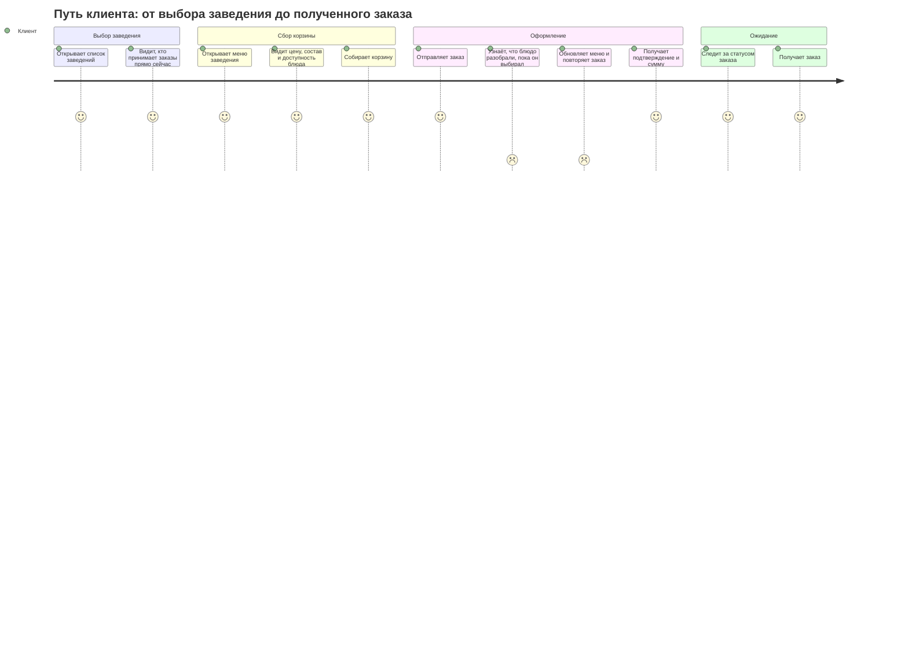
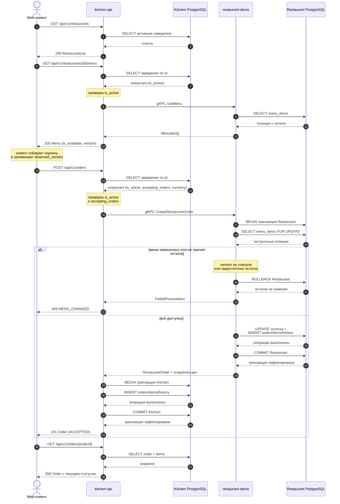
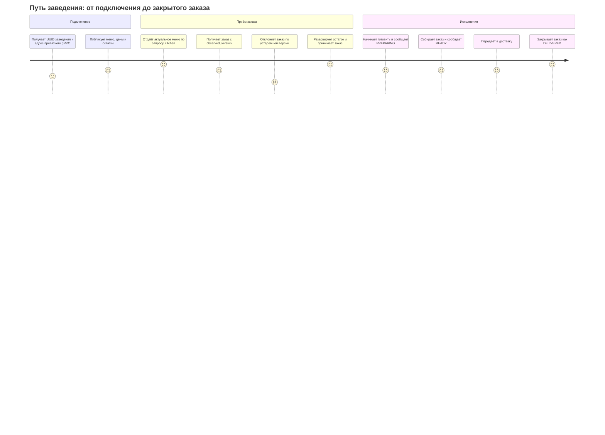
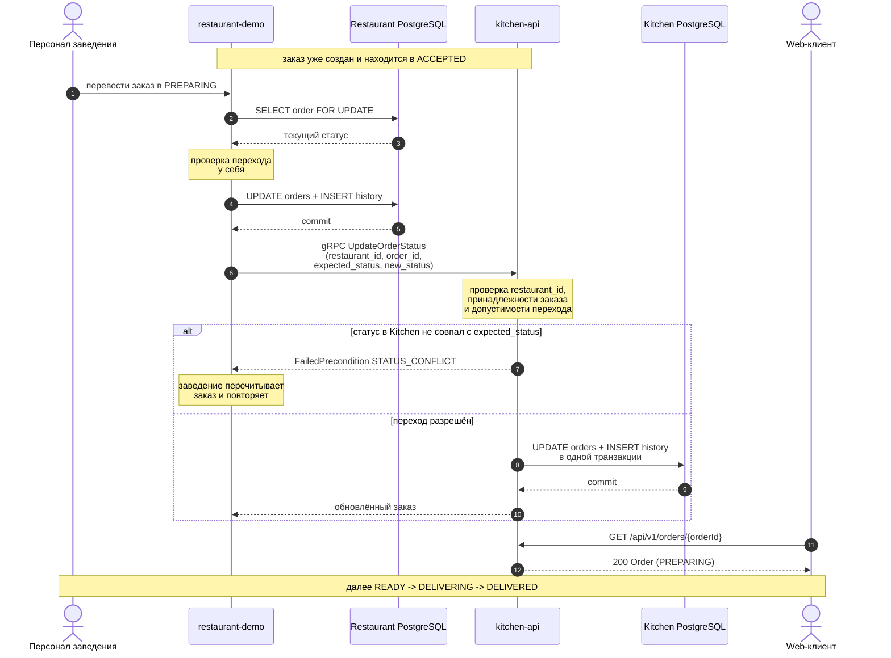
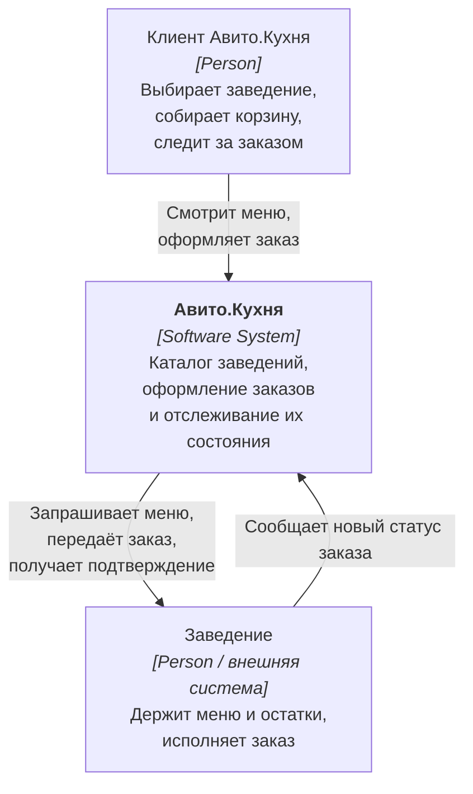
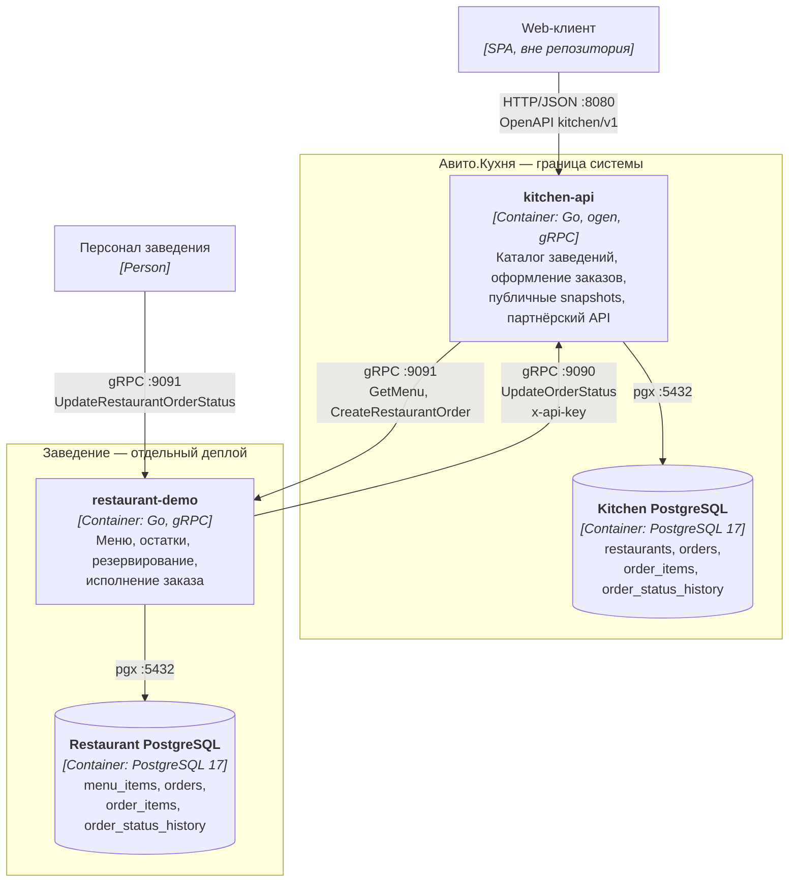
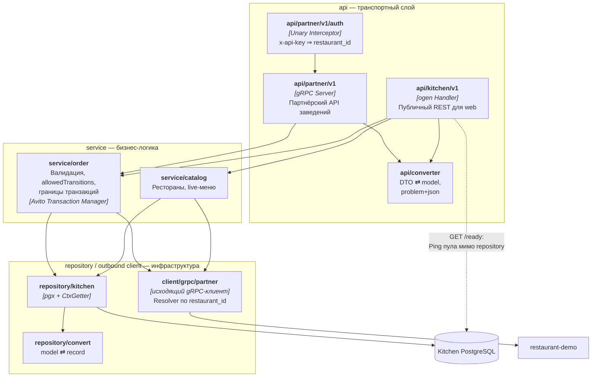
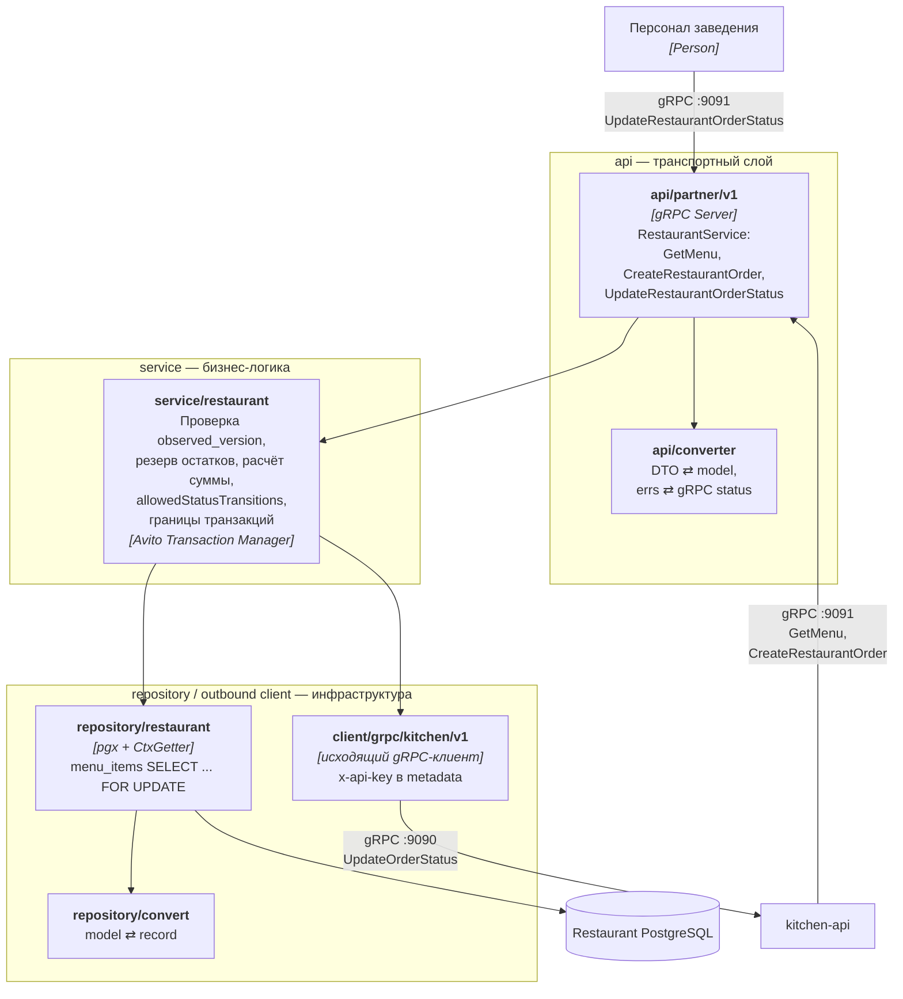
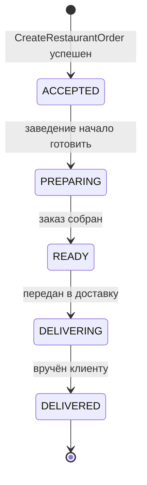
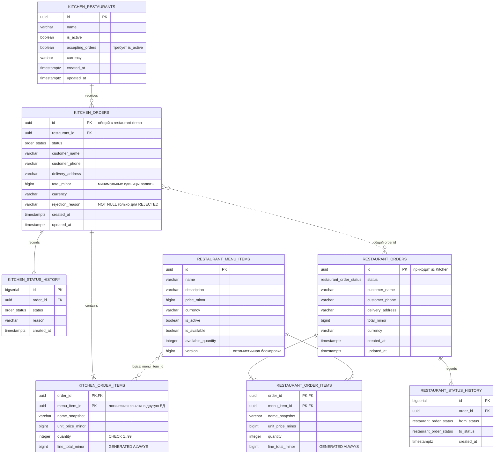

# Avito.Kitchen MVP

Сервис доставки еды: клиент выбирает заведение, собирает корзину из его живого меню и
оформляет заказ, а заведение исполняет этот заказ у себя и сообщает статус обратно.

В репозитории два сервиса, каждый со своей БД(выбрал PostgreSQL):

- **`kitchen-api`** - сама площадка. Держит реестр заведений, оформляет заказы,
  хранит их публичные snapshots(для истории заказов) и историю статусов. Наружу отдаёт REST по OpenAPI
  для web-клиента, внутрь - приватный gRPC для заведений.
- **`restaurant-demo`** — пример подключённого заведения. Владеет меню, ценами,
  доступностью и остатками, принимает окончательное решение по заказу и ведёт его
  исполнение.

Оба поднимаются одной командой через Docker Compose(ниже сама команда).

## Быстрый запуск

```bash
cp .env.example .env
task up
```

После запуска:

- Kitchen REST: `http://localhost:8080`;
- Kitchen партнёрский gRPC: `http://localhost:9090`;
- Restaurant gRPC: `http://localhost:9091`;
- Kitchen PostgreSQL: `http://localhost:15432`;
- Restaurant PostgreSQL: `http://localhost:15433`;
- health-проверки Kitchen:
  `GET /health`, - обычный http запрос к kitchen, возвращает 200 если все работает
  `GET /ready`.  - проверка работоспособности kitchen. Делается пинг в БД

Основные команды:

```bash
task up          # поднять всё через Compose
task down        # остановить
task logs        # логи сервисов
task gen         # перегенерировать REST, gRPC и моки из контрактов
task migrate     # накатить миграции обеих баз
task lint        # запустить линтер
```

## CJM

Два пути:
1) Клиент заказывает еду
2) Заведение исполняет заказ

### CJM клиента



Как я решил проблему устаревшей корзины - изменения цены или доступности блюда после его добавления.
Она решена не блокировкой корзины, а с помощью `observed_version`: при чтении меню клиент получает `version` каждой позиции
и возвращает её при оформлении. Если меню успело измениться, заказ не создаётся частично - вся проверка откатывается, и Kitchen отвечает `409 MENU_CHANGED`.

Разбивки по конкретным позициям в `409` нет: ответ сообщает только факт конфликта.
Что именно изменилось, клиент узнаёт из повторного `GET .../menu`
(клиент сам поймет, где именно цена изменилась, или позиция уже закончилась, когда будет просматривать меню)
там уже видны актуальные цены, `is_available` и новые `version`. Это осознанное упрощение MVP,
см. «Осознанные упрощения»(не успел).

Не знаю стоило ли показывать все возможные ошибки, которые пользователь может получить в CJM(например, при POST /api/v1/orders, когда у нас is_active/acceptings_orders == false, возвращает клиенту 409)
так что не стал показывать, кроме транзакций, на схеме покажу все явно.



### CJM заведения



Заведение никогда не пишет в базу Kitchen напрямую: оно меняет статус у себя и
сообщает о нём партнёрским вызовом. Kitchen остаётся единственным владельцем своего
состояния и сам проверяет допустимость перехода.



## Архитектура

Диаграммы описаны на Mermaid и рендерятся GitHub без внешних инструментов, поэтому
исходник диаграммы и её отображение всегда совпадают.

### C4 Level 1 — контекст



### C4 Level 2 — контейнеры



Оба направления приватные и синхронные. Kitchen одновременно REST-сервер для web,
gRPC-клиент заведения и gRPC-сервер партнёрского API; restaurant-demo — gRPC-сервер
для Kitchen и gRPC-клиент его партнёрского API.

Доверие одностороннее: партнёрский API Kitchen требует `x-api-key` и по нему определяет
заведение, а вызовы Kitchen в заведение ключом не подписываются. Kitchen защищает
запись в своё состояние, а обращения к заведению в MVP считаются доверенными внутри
приватной сети; при выходе за её пределы это направление тоже придётся подписывать.

Меню целиком принадлежит заведению: Kitchen не хранит `menu_items` и ничего не
синхронизирует, а на каждый запрос меню ходит в restaurant-demo через
`GetMenu`. Компромисс - доступность меню зависит от заведения.

### C4 Level 3 — компоненты kitchen-api



### C4 Level 3 — компоненты restaurant-demo



## Инженерные решения

Что сделано осознанно и где это видно в коде.

### Чистая трёхслойная архитектура

Основной поток вызовов в каждом сервисе: `api` -> `service` ->
`repository/client`. API использует converter для transport DTO, repository -
для record-моделей. Каждый слой не знает внутренностей другого слоя, а для взаимодействия
использует интерфейсы `deps.go`.

Интерфейсы объявлены на стороне потребителя - `service/order/deps.go`,
`api/kitchen/v1/deps.go`, `service/catalog/deps.go`. Каждый слой описывает ровно те методы, которые ему нужны. 
Из этих же файлов генерируются заглушки (`task gen:mocks`), поэтому любую зависимость можно
подменить, не трогая продакшн-код.

### У каждого слоя своя модель

Их три, и они не пересекаются:

| Слой | Тип | Откуда берётся |
|---|---|---|
| транспорт | ogen DTO, protobuf-сообщения | сгенерированы из OpenAPI и `.proto` |
| домен | `internal/model` | написаны руками, ни от чего не зависят |
| хранилище | `internal/repository/record` | повторяют колонки таблиц |

Границы держат конвертеры: `api/converter` переводит DTO <-> model,
`repository/convert` — model <-> record. Ни один слой не видит типы соседа, 
поэтому переименование колонки не протекает в JSON, а правка OpenAPI не
ломает SQL. 


### Как написан cmd файлы.

`cmd/main.go` отвечает только за процесс: конфиг, логгер, сигналы, код возврата.                                                                                                   
Зависимости и серверы собираются в `app.New`, поэтому приложение остаётся                                                                                                    
пакетом, который можно поднять из теста. Такой подход как я слышал назвается
библиотечным; он легче читается и легче тестируется

### Транзакции открывает только service

Repository не начинает и не коммитит транзакцию - он выполняет один запрос в том
соединении, которое ему дали. Границу задаёт service, потому что только он знает,
какие изменения обязаны примениться вместе.

Границ ровно две, обе многошаговые:

- **Kitchen** — `orders` + `order_items` + `order_status_history` одной транзакцией
  (`service/order/create.go`, `service/order/update_status.go`);
- **restaurant-demo** — `SELECT menu_items FOR UPDATE` -> проверка версии, доступности
  и остатка -> списание остатка -> `orders` + `order_items` + `order_status_history`
  (`service/restaurant/create_order.go`). Блокировка строк меню на весь этот путь и
  делает проверку корзины атомарной: две параллельные попытки забрать последнюю
  порцию не могут обе пройти.

### Менеджер транзакций от Авито

Используется [`github.com/avito-tech/go-transaction-manager`](https://github.com/avito-tech/go-transaction-manager) (узнал о нем, когда смотрел разборы ошибок за прошлые года, надеюсь кто-то дойдет до этой readMe части):
service вызывает `txManager.Do(ctx, func(txCtx context.Context) error { ... })`, а
repository внутри достаёт соединение через `r.getter.DefaultTrOrDB(ctx, r.pool)`.

Что это даёт по сравнению с ручной передачей `pgx.Tx` параметром:

- **Не надо создавать две отдельные версии с транзакциями и без транзакцией**.
    Да и в принципе не надо думать, используется ли здесь транзакция или не используется ли вовсе, так как
    все зависит от ctx(если содержит транзакция будет pgx.Tx, если нет, то просто r.pool);
- **`DefaultTrOrDB` возвращает либо активную транзакцию из контекста, либо пул**, если
  транзакции нет. Один и тот же `GetOrder` одинаково работает внутри `Do` и снаружи;
- **commit и rollback привязаны к возврату из функции**: вернулась ошибка - rollback,
  вернулся `nil` - commit. Закоммититься дважды или
  выйти из функции с открытой транзакцией здесь нереально.

### доменные ошибки и логирование

Внутри сервисов ходит `errs.Error` с `Kind` и стабильным `Code`. В HTTP-код и
gRPC-статус он превращается ровно на границе: `api/kitchen/v1/errors.go` и
`api/partner/v1/errors.go`. Наружу уходит `application/problem+json` со стабильным
машинным `code`, а тексты драйвера и SQL-ошибки не покидают repository - они
заворачиваются в `repositoryError` и логируются, но не отдаются клиенту.

### Использование OpenAPI и Proto контрактов

REST описан в `shared/api/kitchen/v1/`, межсервисный gRPC - в
`shared/proto/partner/v1/partner.proto`. Серверы, клиенты и DTO генерируются из них
(`ogen`, `buf`). Схема не может разойтись с кодом, потому что код
из неё и получается.


### Деньги и статическая проверка

Все суммы - целые в минимальных единицах валюты (590 ₽ хранятся как `59000`), валюта
лежит рядом с ценой. Плавающей точки в денежных путях нет вообще; переполнение при
умножении цены на количество проверяется явно.

Статический анализ настроен в `.golangci.yml` и запускается как `task lint` вместе с
`go vet` и `buf lint`.

## Контракты

- REST-исходники: `shared/api/kitchen/v1/`;
- ogen-код: `shared/pkg/openapi/kitchen/v1/`;
- Protobuf-исходник: `shared/proto/partner/v1/partner.proto`;
- protobuf/gRPC-код: `shared/pkg/proto/partner/v1/`;
- генерация: `task gen`.

### Public REST

| Метод | Путь | Назначение |
|---|---|---|
| `GET` | `/api/v1/restaurants` | Получить активные заведения |
| `GET` | `/api/v1/restaurants/{restaurantId}/menu` | Получить live-меню через restaurant-demo |
| `POST` | `/api/v1/orders` | Атомарно проверить корзину и создать заказ |
| `GET` | `/api/v1/orders/{orderId}` | Получить сохранённый snapshot заказа |
| `GET` | `/health` | Проверить, что процесс работает |
| `GET` | `/ready` | Проверить готовность Kitchen и его PostgreSQL |

Заказ относится к одному заведению и содержит от 1 до 100 уникальных позиций по
1–99 единиц каждой. Меню возвращает все активные блюда, включая временно недоступные:
клиент видит их с `is_available: false` и понимает, почему не может их заказать.

Ошибки приходят как `application/problem+json`: валидация — `400`, не найдено — `404`,
конфликт меню - `409`, restaurant-demo недоступен — `503`, всё прочее — `500`.

### Private gRPC

Оба направления интеграции описаны в одном версионированном Protobuf-контракте:

| Сервис и RPC | Кто вызывает | Назначение |
|---|---|---|
| `RestaurantService.GetMenu` | Kitchen | Прочитать актуальное меню из PostgreSQL заведения |
| `RestaurantService.CreateRestaurantOrder` | Kitchen | Атомарно проверить, зарезервировать позиции и создать заказ |
| `RestaurantService.UpdateRestaurantOrderStatus` | система заведения / demo-вызов | Изменить локальный статус и синхронно уведомить Kitchen |
| `KitchenPartnerService.UpdateOrderStatus` | restaurant-demo | Сохранить новый статус и историю в Kitchen |

`KitchenPartnerService` закрыт API key-аутентификацией. Restaurant-demo передаёт ключ в
gRPC metadata `x-api-key`; unary interceptor Kitchen сопоставляет ключ с UUID заведения.
UUID из тела запроса дополнительно сверяется с аутентифицированным, поэтому подставить
чужой идентификатор недостаточно. Для локального Compose ключ задаётся переменной
`RESTAURANT_API_KEY`, а Kitchen получает отображение `restaurant_id=key` через
`RESTAURANT_API_KEYS`.

## Схема БД

### Состояния заказа



Переходы проверяются в service-слоях обеих систем. Успешно созданный заказ сразу
получает `ACCEPTED`. Если заведение не может
принять заказ, создание атомарно отклоняется и заказ не сохраняется нигде.

### Таблицы

Kitchen PostgreSQL:

- `restaurants` - реестр доступных заведений;
- `orders` - публичное состояние заказа;
- `order_items` - snapshots UUID, названия, цены и количества;
- `order_status_history` - история статусов.

Restaurant PostgreSQL:

- `menu_items` - меню, доступность, версия и `available_quantity`;
- `orders` - заказ, принятый заведением;
- `order_items` - snapshots заведения;
- `order_status_history` - история исполнения.




Миграции лежат в `db/migrations/kitchen` и `db/migrations/restaurant`, накатываются
goose и запускаются в Compose до старта сервисов.

## Транзакции и согласованность

Restaurant выполняет в одной локальной транзакции:

```text
SELECT menu_items FOR UPDATE
-> validate version/availability/quantity
-> decrement available_quantity
-> INSERT orders
-> INSERT order_items
-> INSERT order_status_history(ACCEPTED)
```

Kitchen после успешного gRPC-ответа отдельной локальной транзакцией записывает свой
`order + items + history`. При смене статуса restaurant-demo сначала атомарно меняет
свой `order + history`, затем синхронно вызывает Kitchen.

Общей ACID-транзакции между двумя PostgreSQL нет, и это главный компромисс системы.
Поэтому возможны orphan-заказы после создания (заведение списало остаток, Kitchen не
успел записать snapshot) или временное расхождение статусов при сбое между локальным
commit и внешним вызовом. См.Осознанные упрощения

## Осознанные упрощения(или то что не успел сделать)

- **Ошибки `409 Conflict`.** Используются коды `MENU_CHANGED` и
  `RESTAURANT_NOT_ACCEPTING_ORDERS`. Для `MENU_CHANGED` не возвращается список
  конфликтных позиций: клиент повторно получает меню и пересобирает корзину.

- **Статусы.** В рабочем сценарии используются переходы
  `ACCEPTED → PREPARING → READY → DELIVERING → DELIVERED`.
  Статусы `PENDING_CONFIRMATION` и `REJECTED` зарезервированы для будущего
  асинхронного подтверждения и отмены заказа, но сейчас не устанавливаются.

- **Transactional Outbox** не реализован. Kitchen и restaurant-demo используют
  синхронные gRPC-вызовы, поэтому между фиксацией изменений в двух базах остаётся
  небольшое окно рассогласования(Например, restaurant-demo может зафиксировать заказ и уменьшить остатки, после чего
  транзакция Kitchen завершится ошибкой. Тогда заказ останется в restaurant-demo,
  но клиент получит ошибку и будет считать, что заказ не создан).

- **DDD.** Использовано разделение на `model`, `service` и `repository`, однако
  полноценные агрегаты, value objects, domain events и отдельный domain-слой
  для MVP не вводились.

## Масштабирование

- Исправление всех выше упущений
- Реализация Transactional Outbox и Kafka для асинхронной и надёжной передачи
  заказов и изменений статусов. Kitchen будет сохранять заказ со статусом
  `PENDING_CONFIRMATION` и событие в outbox одной транзакцией, после чего отправлять
  его в Kafka. Это позволит повторять доставку при сбоях, сглаживать пики нагрузки
  (так как у нас не статично повышаются rps, а динамически с пиками).
- Обработчики событий должны быть идемпотентными. Конечно можно взять 
  гарантию доставки exactly once, но это дороже и сложнее.
